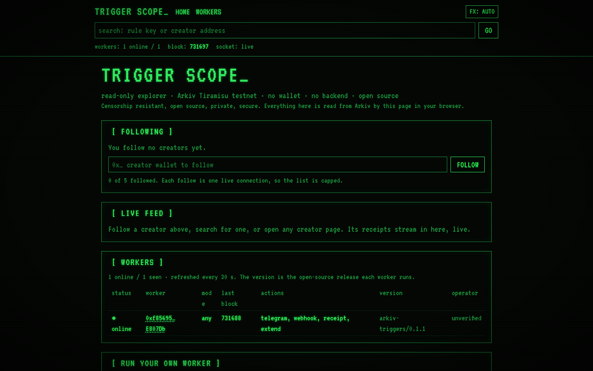

# Trigger Scope

A standalone [OpenTrigger](https://github.com/soumyacodes007/arkiv-triggers) example. Rules on Arkiv. Actions on time.

Extracted from [`examples/trigger-scope`](https://github.com/soumyacodes007/arkiv-triggers/tree/main/examples/trigger-scope). [OpenTrigger docs](https://arkiv-triggers-docs.vercel.app/docs) · [SDK notes](SDK-NOTES.md).

A read-only, public explorer for the [OpenTrigger](https://github.com/soumyacodes007/arkiv-triggers)
network. It shows which workers are online, streams the receipts they write, and audits any rule by its key.

It is the open-source pillar of the CROPS set (censorship resistant, open source, private, secure):

- **Open source.** The SDK, the worker and the CLI are MIT. Anyone can run a worker with `npx arkiv-triggers`.
- **Verifiable.** There is no backend. This page reads Arkiv in your browser, and every receipt's worker is the
  receipt entity's creator as recorded by Arkiv itself. Each worker and creator links to the explorer.
- **No wallet, no secrets in the browser.** It only reads. The browser holds no key. The optional read relay
  keeps the Arkiv access key on the server.

Network: Arkiv Tiramisu testnet (chain id 7738577). Explorer: https://tiramisu.explorer.arkiv.network

## Screenshot

<p align="center">
  
</p>

## Pages

| Route | What it shows |
|---|---|
| `/` | Following list (saved in your browser), a live feed across the creators you follow, a short workers table, and how to run a worker. |
| `/creator/[address]` | One creator's receipts, live, with per-worker counts and a follow button. Shareable by URL. |
| `/rule/[key]` | One rule as a sentence (for example `When 0xab12…ef01 expires → webhook`), its status, deadline, live claims, a timeline (created → claimed → fired) and a VERIFY box. Shareable by URL. |
| `/workers` | Every worker in a full table: status, mode, last block, actions, the version it runs, operator link. |

The header is on every page. It shows the workers online count, the current block (ticking every 2 s), the
socket status (`live` or `reconnecting`), and a search box. The search accepts a rule key or a creator address
and routes to the right page.

Clicking a receipt opens a drawer with every field: status, action, reason, the rule, the rule's creator, the
worker, created, deadline and fired-at blocks, how many blocks late it was, and every result field (HTTP code,
latency, message id, attempts, error, new expiry).

## Reads and the relay

Reads go **direct to Arkiv** from the browser first. Only a rate limit sends the same request through this
site's relay, `/api/arkiv`. The relay is a Next.js route that:

- accepts POST only, single JSON-RPC requests or batches of up to 20;
- allows only the read methods `arkiv_query`, `arkiv_getBlockTiming`, `eth_blockNumber`, `eth_chainId`,
  `eth_getBalance`, `eth_getLogs`, `eth_getBlockByNumber`, `eth_getTransactionReceipt` and `eth_call`. Any other
  method gets a 403, so the relay cannot send transactions;
- adds `X-API-KEY` from the server environment variable `ARKIV_ACCESS_KEY`. The key is never sent to the browser;
- returns 503 if the key is not set. Direct reads still work without it.

The client transport is in `src/lib/transport.ts`. It is a rate-limit gate, not viem's `fallback()`: viem's
fallback would also switch to the relay on timeouts and bad responses, which this app does not want.

## Setup

Requires Node 20 or newer.

```bash
git clone https://github.com/soumyacodes007/opentrigger-trigger-scope.git
cd opentrigger-trigger-scope
npm install
cp .env.example .env.local     # optional: set ARKIV_ACCESS_KEY (server side only, never NEXT_PUBLIC_)
npm run dev                    # http://localhost:3000
```

`ARKIV_ACCESS_KEY` is optional. Without it the app works on the anonymous read quota, and the relay answers 503
if a rate limit is hit.

Checks:

```bash
npx tsc --noEmit
npx eslint src
npm run build
```

## SDK calls used

All SDK calls run in client components (`'use client'`), inside effects or event handlers. Nothing touches the
chain while the server renders.

| Call | Where | Purpose |
|---|---|---|
| `createTriggers({ publicClient, app })` | `src/lib/arkiv.ts` | Read-only client, with the rate-limit gated transport. |
| `DEFAULT_RPC_URL` | `src/lib/transport.ts` | Tiramisu RPC URL, used for direct reads. |
| `t.clock()` | NetworkProvider (every 2 s), RuleView | Current block, and the clock for block-to-time. |
| `t.listWorkers()` | NetworkProvider (every 30 s) | Workers, returned as `WorkerInfo`. |
| `t.watch({ minIntervalMs, onHeartbeat, onStatus, onError })` | NetworkProvider | Worker heartbeats over one WebSocket, and socket status. |
| `t.listReceipts({ creator })` | `src/lib/feeds.ts` | Snapshot of receipts for each followed creator. |
| `t.watch({ creator, minIntervalMs, onReceipt, onStatus, onError })` | `src/lib/feeds.ts` | Live receipts per creator. |
| `t.getRule(key)` | RuleView | The audit trail: rule, status, deadline, claims, receipts. |
| `toDate(block, clock)` | `src/lib/format.ts` | Block to local time, synchronous. |
| `Receipt`, `Rule`, `AuditTrail`, `WorkerInfo`, `BlockClock`, `Triggers` | types | Types only. |

Block numbers, deadlines and expiries are `bigint`. They become strings before they reach React state, props
or keys, so nothing fails in `JSON.stringify`.

## Load and limits

- The block counter polls every 2 s. It slows to every 15 s after a rate limit and pauses while the tab is hidden.
- The worker list refreshes every 30 s, and heartbeats arrive between refreshes.
- You can follow up to 5 creators. Each follow is one live subscription, so the cap keeps the anonymous quota sane.
- Rate-limit and timeout errors show a plain message and a countdown to an automatic retry, plus a RETRY NOW button.

## Accessibility and motion

- Every page has a skip link, labelled inputs and buttons, and a visible green focus ring.
- The feed is a log region. Each receipt is a button that opens the drawer. Escape closes the drawer and returns focus.
- `prefers-reduced-motion` turns off the scanlines, the flicker and the cursor blink.
- The **FX** button in the header overrides that: AUTO (follow the OS), OFF, or ON. The choice is saved in your browser.
- Layout works at 375 px. Tables become stacked cards below 640 px.

## Run your own worker

A worker is the open-source half of the network. It needs only its own wallet, funded with test GLM. It never
needs your main wallet.

```bash
npx arkiv-triggers new-key                 # prints WORKER_KEY=0x… for a fresh wallet
# fund the printed address: https://hub.arkiv.network/faucet
WORKER_KEY=0x… npx arkiv-triggers          # runs the worker
```

- Code: https://github.com/soumyacodes007/arkiv-triggers
- Package: https://www.npmjs.com/package/arkiv-triggers

Any worker can fire any public rule. Running one adds capacity and removes a single point of control.

## Layout

```
src/
  app/
    layout.tsx, page.tsx, globals.css, not-found.tsx, error.tsx
    workers/page.tsx, rule/[key]/page.tsx, creator/[address]/page.tsx
    api/arkiv/route.ts          read relay (server only)
  components/
    Providers, NetworkProvider  shared clock, workers and heartbeat socket
    SiteHeader, SearchBox, MotionSync, MotionToggle
    HomeView, CreatorView, RuleView, WorkersTable
    FeedPanel, ReceiptList, ReceiptDrawer, FollowManager, FollowButton
    RunWorkerPanel, Box, Loading, ErrorNote
  lib/
    arkiv.ts, transport.ts      read client and rate-limit gated transport
    feeds.ts                    snapshot + watch per creator
    receipts.ts, audit.ts, workers.ts, format.ts, errors.ts
    follows.ts, prefs.ts        localStorage, kept in sync with useSyncExternalStore
    constants.ts
```

## Safety

- Nothing on this page is a secret. The access key lives in the server environment only. Do not put it, or any
  private key, in this repo, in a `NEXT_PUBLIC_*` variable, or in a commit.
- The relay allows reads only, and returns 403 for anything else.
- Worker keys belong in the worker's environment only, never in a rule, a page or a commit.
